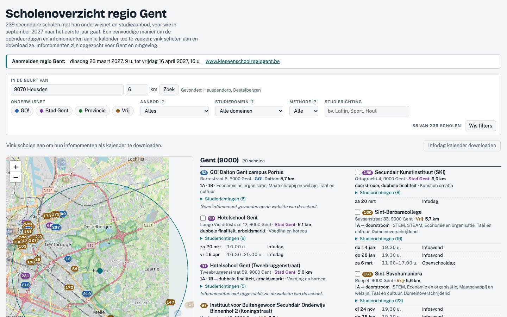

# Scholenoverzicht regio Gent

Live: https://fbl.github.io/scholenkaart/



Alle secundaire scholen van Oost-Vlaanderen op één statische pagina, voor wie in september 2027 naar het eerste jaar
gaat: onderwijsnet, studieaanbod en website per school, filters (ook op afstand tot een adres), een kaart, en voor Gent
en omgeving de infomomenten en opendeurdagen, die je als kalender kunt downloaden.

## Bestanden

| Bestand | Wat |
|---|---|
| `make.py` | Bevat alle events en adressen en schrijft het .ics-bestand |
| `infomomenten-2027-2028-met-adressen.ics` | De kalender (132 events), te importeren in Google Calendar e.d. |
| `export.py` | Leest `make.py` en schrijft `schools.json` (scholen met hun events, voor de kaart) |
| `fetch_aanbod.py` | Haalt alle secundaire scholen van Oost-Vlaanderen met onderwijsnet en studieaanbod op bij data-onderwijs.vlaanderen.be en schrijft `aanbod.json` |
| `fetch_kaart.py` | Haalt de kaartachtergronden op (GRB-basiskaart grijs, Digitaal Vlaanderen) en schrijft `kaart-*.jpg` en `kaart.json` |
| `tpl.html` | Sjabloon van het overzicht: opmaak, filters en kaartlogica |
| `build_page.py` | Bouwt `index.html` uit `tpl.html`, `schools.json`, `aanbod.json` en de kaartbeelden |
| `index.html` | Statische pagina met alle scholen: onderwijsnet, studieaanbod, website, infomomenten, filters en kaart; drukt af als lijst op A4 liggend (zonder kaart) |

## Opnieuw genereren

```
python3 make.py        # schrijft het .ics-bestand
python3 export.py      # schrijft schools.json
python3 build_page.py  # schrijft index.html
```

Alleen nodig als scholen of adressen wijzigen, of om het studieaanbod te verversen (internet nodig):

```
python3 fetch_aanbod.py  # schrijft aanbod.json; wis eerst .cache/ om alles opnieuw op te halen
python3 fetch_kaart.py   # schrijft kaart-*.jpg en kaart.json
```

Alleen de standaardbibliotheek van Python 3 is nodig.

## Een event toevoegen of wijzigen

Alles staat in `make.py`:

- Events uit de folder: regels met `t(datum, begin, einde, school, wat, notitie)` (met uur)
  of `a(datum, school, wat, notitie)` (hele dag).
- Adressen en coördinaten van die scholen: het woordenboek `A`; de koppeling school → adres: `M`.
- Events van onderwijskiezer.be: de lijst `N` (school, adres, coördinaten, data).
- Scholen uit Melle, Merelbeke en Wetteren die niet in de folder staan: de lijst `X` (school, adres, coördinaten, events van de
  schoolwebsite; een lege lijst = geen infomoment gevonden).

## Bronnen en kanttekeningen

- Folder "Infomomenten en opendeurdagen 2027-2028" van de scholengemeenschappen
  ConverGent, Gensters en Stroming (pagina 5 ontbrak in de pdf).
- onderwijskiezer.be voor de scholen in lijst `N`; die data zijn niet nagekeken en
  het soort infomoment is onbekend (titel "Infodag").
- Aanmeldperiode 23 maart 2027 9 u. tot 16 april 2027 16 u. via www.kieseenschoolregiogent.be.
- Zonder einduur is 1,5 uur aangenomen; zonder uur is het een event van een hele dag.
- Twee data in de folder kloppen niet met de weekdag: Don Bosco Sint-Pieters
  "donderdag 20 november" (2026: vrijdag) en BenedictusPoort "zaterdag 16 april" (2027: vrijdag).
- IVV Sint-Vincentius staat op het adres van de hoofdcampus; de campus van de eerste graad is niet bevestigd.
- Adressen en coördinaten komen uit Google Places; enkele zijn nagekeken op stad.gent.
- Onderwijsnet en studieaanbod komen uit "Onderwijsaanbod in Vlaanderen" (schooljaar 2026-2027) en zijn gekoppeld op adres:
  alles wat officieel op het adres van de school wordt ingericht, telt mee, ook van een andere instelling op dezelfde campus.
- Freinetatheneum De Wingerd (Neermeerskaai 1) staat niet in die officiële lijst en heeft dus geen net of aanbod.
- Keerpunt Gent is met de hand gekoppeld aan "Freinetschool Keerpunt", dat officieel op Spitaalpoortstraat 50 staat
  (zie `EXTRA` in `fetch_aanbod.py`); het adres in `make.py` is Jozef Kluyskensstraat 29.
- Kaart in `index.html`: als de pagina de tegels van OpenStreetMap kan laden (lokaal bestand of eigen website, met internet),
  toont ze een interactieve kaart (Leaflet, script van cdnjs; `leaflet.css` zit in de pagina). Lukt dat niet, bv. offline of
  in een artifact op claude.ai, dan blijven de vaste kaartbeelden staan die in het bestand zelf zitten.
- STEAM is geen officiële studierichting. `steam.json` (met de hand bijgehouden) lijst de scholen op die het zelf zo noemen,
  met de bronpagina; `build_page.py` zet ze onder het domein STEAM.
- Kalender downloaden in `index.html`: `build_page.py` zet per school de events als .ics-blok in de pagina; de knop plakt de
  aangevinkte scholen samen tot één bestand. Dat gebeurt in de browser, zonder server.
- Scholen buiten de folder: `fetch_aanbod.py` neemt elk adres in Oost-Vlaanderen met studieaanbod (hoofdstructuren 311, 312 en 321)
  dat niet bij een school uit `make.py` hoort op als nieuwe school, zonder infomomenten. Twee vestigingen zonder coördinaten
  (VLOT! Lokeren, Óscar Romerocollege 2 Dendermonde) zijn overgeslagen.
- Filter "In de buurt van": het adres wordt in de browser opgezocht bij de adresdienst van Digitaal Vlaanderen
  (geo.api.vlaanderen.be, geen sleutel nodig); de afstand tot elke school is in vogelvlucht.
